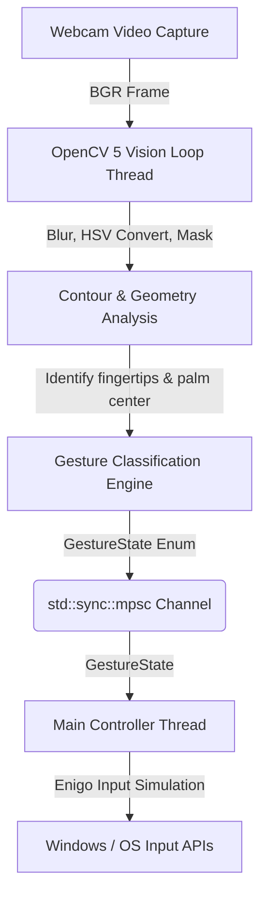

# Native OS Gesture Controller in Rust

A zero-overhead, low-latency, ML-free hand gesture OS controller written in Rust. It utilizes OpenCV 5 for high-speed camera frame capturing, skin-segmentation filtering, and morphological contour analysis to track hand features. Input coordinates and detected gestures are sent via a lock-free thread channel (`std::sync::mpsc`) to a controller loop running `enigo` to simulate native mouse movement, clicks, dragging, scrolling, and virtual desktop switching.

## Features

- **Pinch to Click/Drag**: Detects 0 fingers extended (a fist or pinch gesture) to trigger a mouse down event, allowing you to click, double-click, and drag windows or select text.
- **Hover / Move**: Detects 1 finger extended (e.g. index finger) to move the mouse cursor smoothly.
- **Scroll up/down**: Detects 2 fingers extended and maps vertical hand movement to high-resolution scrolling.
- **Wave to Switch Virtual Desktops**: Detects a fast wave gesture (with 4+ fingers extended) left or right to switch virtual desktops (sends Win + Ctrl + Left/Right).
- **Idle State**: Automatically releases any active click/drag states when the hand leaves the frame.

## Thread Architecture & Zero-Overhead Concurrency

To ensure ultra-low latency and zero input-lag, the project splits responsibilities across two dedicated OS threads:



1. **Vision Processing Thread**: 
   - Decodes video frames at a target resolution of 640x480.
   - Converts frames to HSV color space, masks for skin tones, cleans the mask with morphological open/close, extracts contours, computes the hand's center of mass using a Distance Transform, and extracts convexity defects using Andrew's Monotone Chain Convex Hull.
   - Classifies gestures and sends a simple, lightweight `GestureState` enum through a `std::sync::mpsc::channel`.
2. **OS Input Controller Thread (Main Thread)**:
   - Blocks on receiving `GestureState` updates.
   - Applies Exponential Moving Average (EMA) smoothing to mouse coordinates to eliminate cursor jitter.
   - Executes OS-specific input events using native Win32 input injection (or X11/Wayland).

## OpenCV 5 & Geometry Math

To guarantee lightweight execution and bypass the lack of stable rust bindings for the newly structured OpenCV 5 `geometry` module, this implementation does not use external ML models. Instead, it relies on pure Rust implementations of:
- **Shoelace Formula** ($O(N)$) for contour area calculations.
- **Andrew's Monotone Chain Algorithm** ($O(N \log N)$) to compute the convex hull.
- **Perpendicular Distance Defect Mapping** ($O(N)$) to compute convexity defects between the contour and the hull.

## Smooth Coordinate Tracking

Mouse movements are smoothed using an Exponential Moving Average (EMA):
$$\text{Position}_{\text{smoothed}} = \alpha \cdot \text{Position}_{\text{new}} + (1 - \alpha) \cdot \text{Position}_{\text{last}}$$
The smoothing factor $\alpha$ is set to `0.20`, balancing responsiveness and noise reduction.

## Calibration & Tuning

Skin color ranges differ depending on lighting conditions and webcam specifications. Run the utility with the interactive GUI to calibrate:

```bash
cargo run
```

### Tuning Trackbars:
1. **Low H / High H**: Controls the Hue range. Skin tones are typically in the range `[0, 20]` (or `[160, 180]` for red-dominant lighting).
2. **Low S / High S**: Controls Saturation. Adjust if background objects share a similar hue but different saturation.
3. **Low V / High V**: Controls Value (brightness). Essential for adjusting to shadow cast on the hand.

Use the **Mask View** window to verify that your hand is segmented cleanly as a white silhouette against a solid black background.

## Running Headless

Once your HSV parameters are calibrated, you can run the controller headlessly without visual overlays or trackbar windows for absolute zero-overhead execution:

```bash
cargo run --release -- --no-preview --low-h 0 --high-h 20 --low-s 30 --high-s 150 --low-v 60 --high-v 255
```

## Build Requirements

- OpenCV 5.x installation.
- `libclang` on your system PATH for bindings generation.
- Windows development headers.
